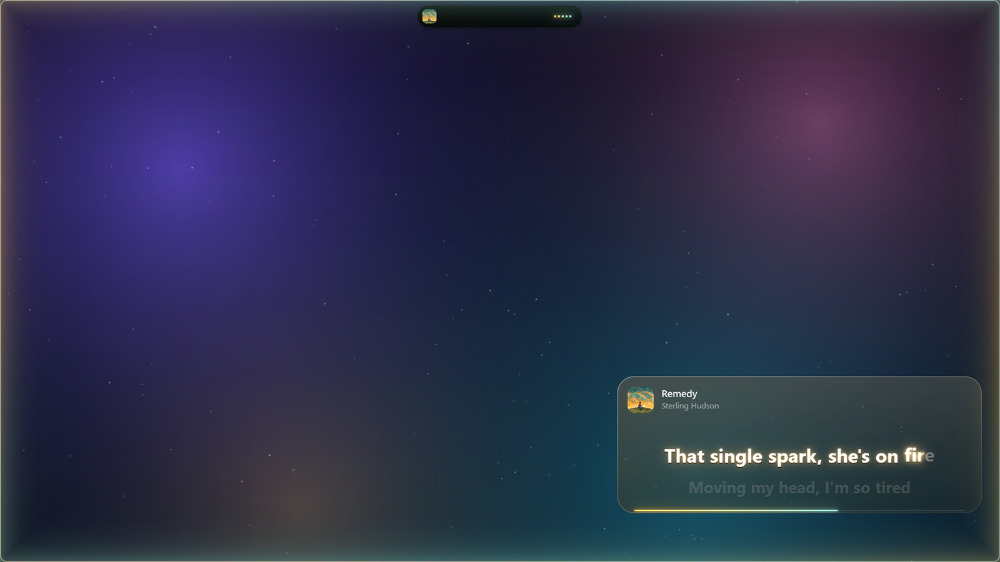
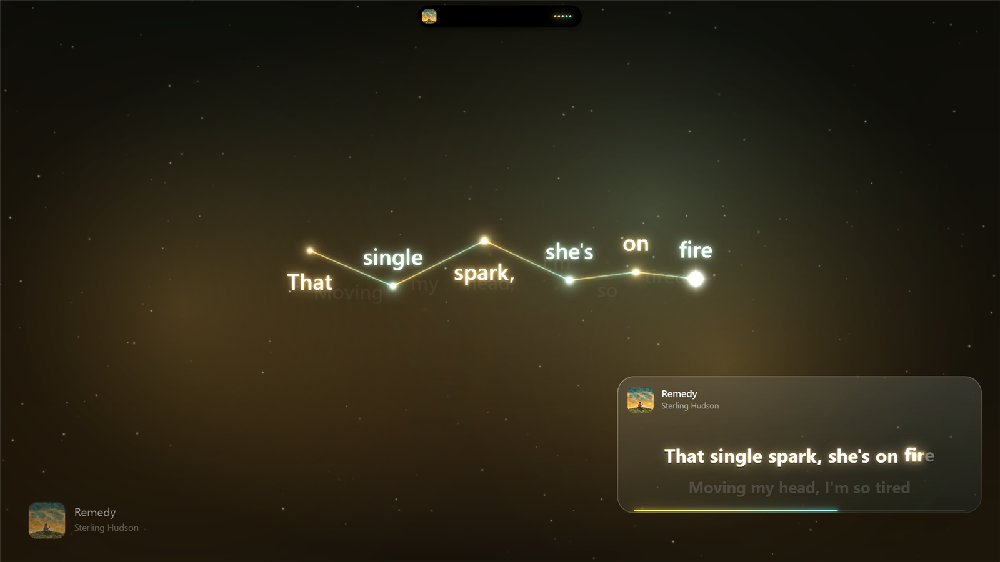
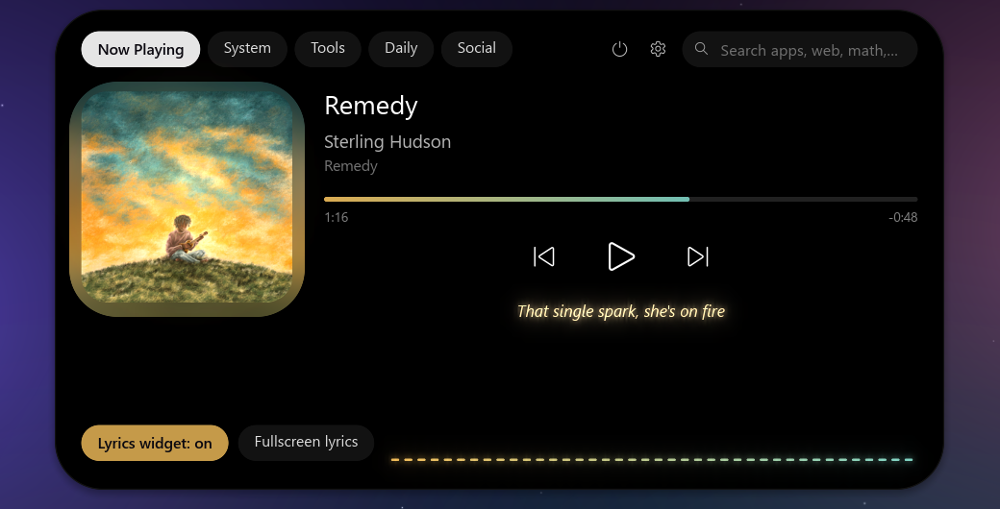
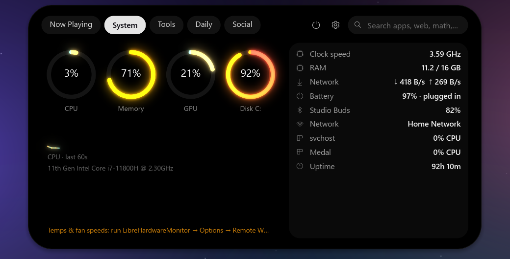
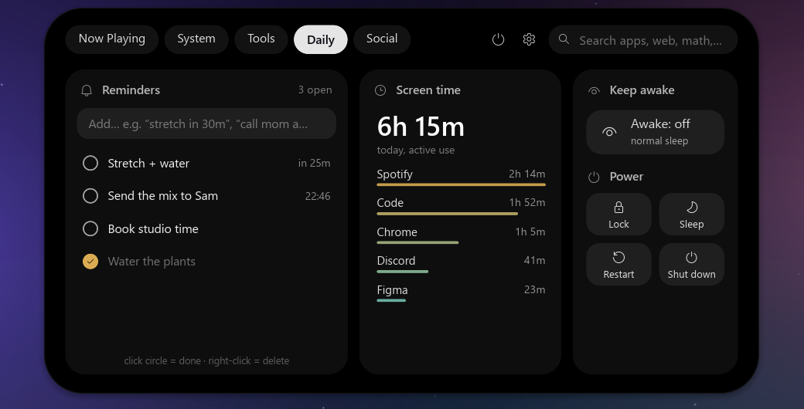
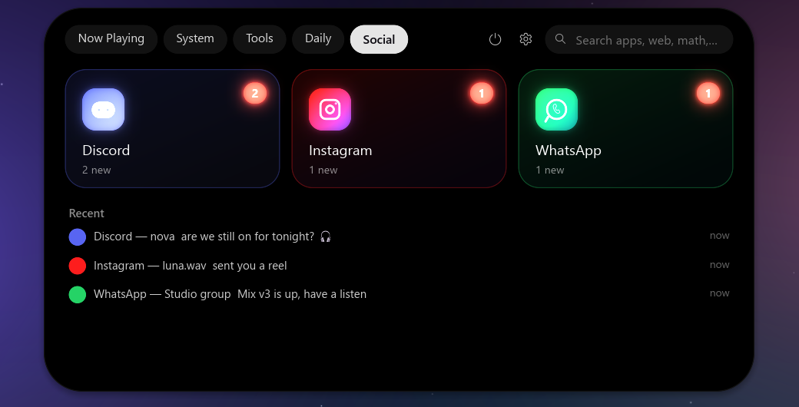
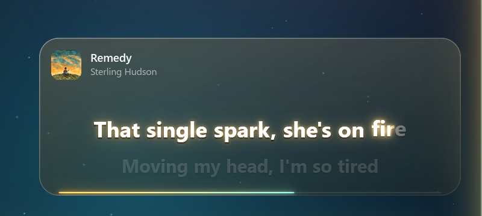
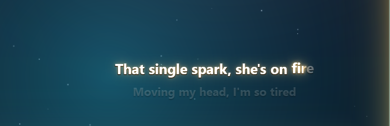

# Aurolo

**A Dynamic Island, live synced lyrics and an ambient screen glow for Windows, written in pure Rust.**

Aurolo sits on top of your desktop as one small native app: a pill at the top of the screen that morphs into a control centre, a floating lyrics widget that lights up word by word, a fullscreen "constellation" lyrics mode, and a soft album-coloured glow around your screen edges that pulses with the beat. It works with Spotify, YouTube in the browser, Apple Music and anything else that shows up in Windows' media controls.





---

## Features

### The island
A pill at the top-centre of the screen. Hover for a quick peek, click to open the full panel. While it sits in the background it's translucent glass, so you can see through it. When you pull it open it turns mostly opaque, so everything is easy to read.

| Now Playing | System |
|---|---|
|  |  |
| **Daily** | **Social** |
|  |  |

- **Now Playing:** album art, seek bar, play/pause/skip, the current lyric line and a live spectrum visualiser.
- **Live activities on the pill:** album art with beat-reactive bars, timer countdown, downloads in progress, and camera/microphone in-use dots.
- **System pop-ups:** volume, brightness, battery and charging, Wi-Fi, and Bluetooth headphones with their battery level.
- **System:** CPU, RAM, GPU and disk rings, live clock speed, network speed, top apps, battery and uptime. CPU/GPU temperatures, fan RPM and CPU power come from [LibreHardwareMonitor](#temperatures-and-fan-speeds-optional).
- **Tools:** timer, Pomodoro, stopwatch, focus mode, clipboard history, a file shelf (drag files onto the island) and today's weather and calendar.
- **Daily:** reminders in plain English ("stretch in 30m", "call mom at 6pm"), screen time per app, keep awake, and lock/sleep/restart/shut down (restart and shut down ask for a second click).
- **Social:** quick links to your Discord, Instagram and WhatsApp messages, with unread counts from Windows notifications.
- **Launcher:** press `Ctrl+Alt+Space` and type to open apps, search the web, do maths (`12*7`, then Enter copies the answer) or run a command (`>notepad`).
- **Settings:** quick toggles right inside the island.

### Lyrics widget
A floating card you can drag anywhere and resize from its corner.

| Glass, full layout | No background, lyrics only |
|---|---|
|  |  |

- **Layouts:** full (art, title, controls and lyrics) or lyrics only.
- **Backgrounds:** glass (see-through), solid, or none (just glowing lyrics floating on your screen).
- **Five lyric styles:** Constellation, Karaoke glow, Banner, Pop and 3D Drift.

### Fullscreen lyrics
Press `Ctrl+Alt+L`.

- **Constellation:** each word is a star. Sung words ignite and link into a constellation that drifts into the starfield when the line ends.
- **Karaoke glow:** an Apple Music-style scrolling list. Each word fills with a soft feathered sweep, and the glow breathes with the beat.
- **3D Drift:** lines float in depth, with warp-speed particles that speed up with the music.
- **Banner:** a Spotify-style view. Big album art with the song name and a beat visualiser on the left, and lyrics scrolling up beside it, lighting up word by word. The art and background pulse with the beat.
- **Pop:** words pop out one at a time exactly as they're sung, with a springy bounce. The word being sung pulses with the beat.

### Edge glow
A gentle rim of light around your screen in the album's colours, pulsing to the beat. It's click-through and shows only while music plays.

### Taskbar dock
A floating glass bar along the bottom of the screen, tinted by the album colours. Turn it on from the tray menu or the island's Settings tab. Music stays on the island at the top.
- **Middle:** Start, search (the island launcher) and Task View, then every app pinned to your Windows taskbar, in the same order, plus any other open apps. Each app shows its real icon, running dots and notification badges. The app you're using expands to show its window title.
- **Left:** weather, CPU and RAM rings (click for Task Manager), a one-click focus timer and the wallpaper dial.
- **Right:** Wi-Fi, volume (scroll to change it) and battery (click for quick settings), the clock (click for notifications and calendar) and a show-desktop strip.
- Click an app to switch to it, click again to minimize (or to cycle its windows). Right-click for all its windows (switch to or close each one), a new window, close all, and pin or hide options.
- **Wallpaper dial:** click the dial button or scroll over it to flip through the images in `Pictures\Wallpapers` (or the `wallpaper_dir` setting). The wallpaper changes once the dial stops.
- Maximized windows stop above the dock.
- **Hide Windows taskbar** (tray menu or the island's Settings tab) hides the Windows taskbar while the dock is running, so only the dock shows. Turn it off, or quit Aurolo, to get the Windows taskbar back. If Aurolo is force-closed (for example from Task Manager), start it again and turn the setting off, or restart Windows Explorer.

---

## Download (easiest)

Grab **`aurolo.exe`** from the [latest release](https://github.com/kirzen29/aurolo/releases/latest) and double-click it. You don't need Rust or any build tools. Aurolo runs from the system tray; right-click its icon for options, including **Start with Windows**.

Windows SmartScreen may warn the first time because the exe isn't code-signed. Click **More info → Run anyway**.

---

## Build it yourself

### Requirements
- **Windows 10 (version 1903 or later) or Windows 11**, with a DirectX 12 capable GPU (almost any GPU from the last ~8 years).
- **Rust** (stable). Install from [rustup.rs](https://rustup.rs/), or run:
  ```powershell
  winget install Rustlang.Rustup
  ```
- **Microsoft C++ Build Tools** with the *Desktop development with C++* workload (this includes the Windows SDK). Install from the [Visual Studio Build Tools download page](https://visualstudio.microsoft.com/visual-cpp-build-tools/), or run:
  ```powershell
  winget install Microsoft.VisualStudio.2022.BuildTools --override "--wait --add Microsoft.VisualStudio.Workload.VCTools --includeRecommended"
  ```
- **Git**, to clone the repo.

### Steps
```powershell
git clone https://github.com/kirzen29/aurolo.git
cd aurolo
cargo build --release
.\target\release\aurolo.exe
```

The first build downloads dependencies and takes a few minutes. After that, `target\release\aurolo.exe` is a single standalone file. Copy it anywhere you like.

To install it so **Aurolo** shows up in Windows search and the Start menu, run this from the repo folder (run it again after updating):
```powershell
powershell -ExecutionPolicy Bypass -File scripts\install.ps1
```
It builds Aurolo, copies it to `%LOCALAPPDATA%\Programs\Aurolo`, adds a Start menu shortcut and starts it.

Aurolo runs in the background with an icon in the system tray. Right-click the tray icon for options, including **Start with Windows**.

---

## Using it

| Shortcut | What it does |
|---|---|
| `Ctrl+Alt+Space` | Open the island with the launcher |
| `Ctrl+Alt+L` | Open/close fullscreen lyrics |
| In fullscreen: `Esc` | Close |
| In fullscreen: `←` / `→` | Switch lyric style |
| In fullscreen: `Space` | Play/pause |
| In fullscreen: `[` / `]` | Shift lyric timing earlier/later |

- **Lyrics widget:** drag to move. To resize, **scroll the mouse wheel over it**, drag the dots in the bottom-right corner, or pick Small, Medium or Large under tray → Widget size or Settings. Hover for controls (layout, background, style, fullscreen, close).
- **Island:** hover to peek, click to open, and drag files onto it to add them to the shelf.

### Settings
Most options are in the island's **Settings** tab (gear icon) and the tray menu. Everything else is in:

```
%APPDATA%\Aurolo\config.toml
```

| Setting | What it does |
|---|---|
| `weather_city` | e.g. `"London"`, to show weather (from Open-Meteo, no account needed) |
| `calendar_ics_url` | A private iCal link (e.g. Google Calendar → Settings → *Secret address in iCal format*), to show upcoming events |
| `hotkey_lyrics`, `hotkey_island` | Change the shortcuts, e.g. `"Ctrl+Alt+K"` |
| `lyrics_font` | Any installed font, e.g. `"Inter"` |
| `lyrics_offset_ms` | Default lyric timing nudge |
| `socials` | The social tiles: name, link to open, and which notification app to count |
| `edge_thickness`, `edge_intensity`, `edge_only_when_playing` | Tune the edge glow |
| `dock_pins` | Extra apps pinned only to the dock (full `.exe` paths); your Windows taskbar pins appear automatically |
| `hide_windows_taskbar` | Hide the Windows taskbar while the dock runs |
| `dock_hidden` | Windows taskbar pins you hid from the dock |
| `wallpaper_dir` | Folder for the wallpaper dial (default `Pictures\Wallpapers`) |
| `dock_reserve` | `false` lets maximized windows go under the dock instead of stopping above it |
| `pomodoro_minutes` | Length of the dock's and island's focus timer |

Restart Aurolo after editing the file by hand.

### Temperatures and fan speeds (optional)
Windows doesn't let normal apps read temperatures or fan RPM. To see them:
1. Download [LibreHardwareMonitor](https://github.com/LibreHardwareMonitor/LibreHardwareMonitor/releases) (free, open source) and run it as administrator.
2. In its menu, go to **Options → Remote Web Server → Run** (it uses port 8085).
3. Optionally, enable **Options → Start Minimized** and **Run On Windows Startup**.

Aurolo picks the readings up automatically.

---

## Troubleshooting
- **Build fails with `linker 'link.exe' not found`:** the Microsoft C++ Build Tools are missing, or installed without the C++ part. VS Code isn't enough. Install them:
  ```powershell
  winget install Microsoft.VisualStudio.2022.BuildTools --override "--wait --passive --add Microsoft.VisualStudio.Workload.VCTools --includeRecommended"
  ```
  If winget says Build Tools is already installed, add the C++ part to the existing install instead. In **PowerShell**:
  ```powershell
  & "${env:ProgramFiles(x86)}\Microsoft Visual Studio\Installer\setup.exe" modify --installPath "${env:ProgramFiles(x86)}\Microsoft Visual Studio\2022\BuildTools" --add Microsoft.VisualStudio.Workload.VCTools --includeRecommended --passive
  ```
  or in **Command Prompt**:
  ```bat
  "%ProgramFiles(x86)%\Microsoft Visual Studio\Installer\setup.exe" modify --installPath "%ProgramFiles(x86)%\Microsoft Visual Studio\2022\BuildTools" --add Microsoft.VisualStudio.Workload.VCTools --includeRecommended --passive
  ```
  Or open **Visual Studio Installer**, click **Modify** on Build Tools, and tick **Desktop development with C++**. Then open a new terminal and run `cargo build --release` again.
- **A shortcut doesn't work:** another app is probably using it, which is common with other notch or island apps. Close that app (Aurolo grabs the key within a few seconds), or change the shortcut in `config.toml`.
- **No unread counts on social tiles:** Windows may not grant notification access to unpackaged apps. The tiles still open your messages.
- **Lyrics are slightly early or late:** use `[` / `]` in fullscreen, or tray → *Lyrics sync*.
- **No lyrics:** not every song has synced lyrics on LRCLIB. You can contribute them at [lrclib.net](https://lrclib.net).
- **Logs:** `%APPDATA%\Aurolo\aurolo.log`.

## Privacy
Aurolo has no accounts and no telemetry. It only goes online to:
- **[LRCLIB](https://lrclib.net)**, to fetch lyrics. It sends the song title, artist, album and length, and caches the results locally.
- **[Open-Meteo](https://open-meteo.com)**, for weather, and only if you set `weather_city`.
- **Your calendar link**, only if you set one.

Screen time, reminders and clipboard history never leave your PC.

## For developers
- `src/gfx`: the wgpu renderer. It draws per-pixel transparent windows through DirectComposition, with SDF shapes, text (glyphon) and bloom.
- `src/services`: background threads for media (Windows media controls), lyrics, audio loopback and FFT, system stats, notifications, weather, calendar and screen time.
- `src/ui`: the island, widget, fullscreen lyrics, edge glow and taskbar dock.
- `src/shell.rs`: open windows, app icons and the appbar that reserves the dock's strip.
- `src/desktop.rs`: Windows taskbar pins, Start / Task View / show desktop, volume and wallpapers.
- **Demo mode** (for screenshots): `$env:AUROLO_DEMO=1` uses sample data, draws a wallpaper backdrop and never writes your settings. Add `$env:AUROLO_DEBUG_TAB="daily"` to hold the island open on a tab.

## Credits
- Lyrics: [LRCLIB](https://lrclib.net).
- Weather: [Open-Meteo](https://open-meteo.com).
- Built with [wgpu](https://wgpu.rs), [winit](https://github.com/rust-windowing/winit), [glyphon](https://github.com/grovesNL/glyphon), [windows-rs](https://github.com/microsoft/windows-rs) and other open-source crates (see `Cargo.toml`).

Discord, Instagram, WhatsApp, Spotify and Apple Music are trademarks of their respective owners. "Dynamic Island" is a term used by Apple. Aurolo is an independent project and is not affiliated with or endorsed by any of them.
